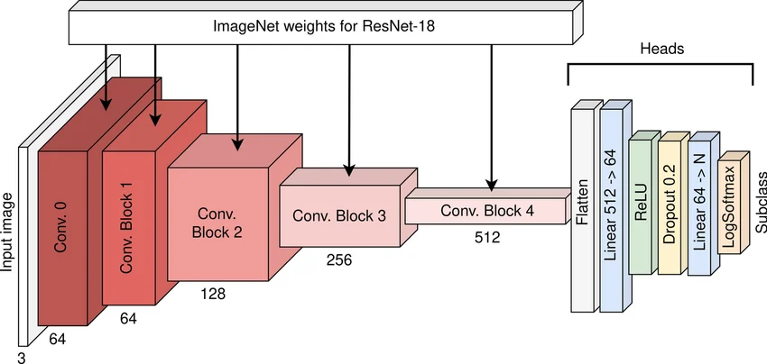
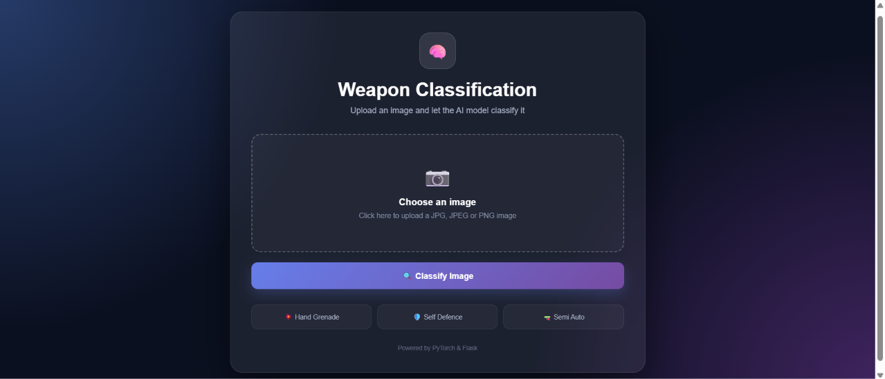
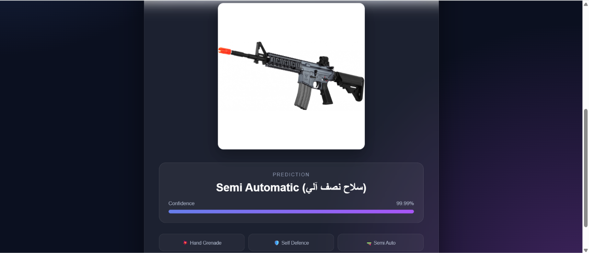

# Weapon Classification with Custom ResNet-18



An end-to-end Deep Learning computer vision project built from scratch in PyTorch to classify weapon images into three distinct categories, paired with an interactive Flask web application for real-time inference.

---

## Project Objective

The primary goal of this project is to design, train, and deploy an automated image classification system capable of identifying and categorizing weapons from visual inputs. Specifically, the model classifies images into three main classes:

1. Hand Grenade (hand_grenade)
2. Self-Defense / Handgun (self_diffence)
3. Semi-Automatic Weapon (semi_auto)

This project demonstrates a complete machine learning lifecycle:
- Custom Architecture Implementation: Building the ResNet-18 residual network and its BasicBlock modules from scratch using PyTorch (torch.nn) without relying on pre-built library backbones.
- Model Training & Evaluation: Processing custom image datasets, optimizing weights, tracking training and testing metrics, and visualizing performance via confusion matrices and loss and accuracy curves.
- Web Deployment: Serving the trained PyTorch model (model.pt) through a user-friendly Flask web interface where users can upload images and receive instant predictions with confidence scores.

---

## Web Application Screenshots

Here are previews of the interactive web application interface and the classification results:

### 1. Home / Upload Interface


### 2. Prediction and Confidence Result


---

## Technologies & Libraries Used

### Deep Learning & Data Science
- PyTorch (torch, torch.nn): Core deep learning framework used for building the custom ResNet-18 architecture, managing tensors, automatic differentiation, and GPU acceleration (CUDA).
- Torchvision (datasets, transforms): Used for loading the directory-structured dataset (ImageFolder) and applying image preprocessing pipelines.
- TorchMetrics and MLxtend: Used for computing and plotting the multiclass Confusion Matrix.
- Matplotlib: Used for visualizing training and testing loss and accuracy curves as well as sample prediction grids.
- Pillow (PIL): Image loading and RGB conversion.
- tqdm: Progress monitoring during execution.

### Web Application (Deployment)
- Flask: Lightweight Python web framework used to serve the classification model over HTTP.
- Werkzeug: Used for secure file upload handling (secure_filename).
- HTML5 / CSS3: Frontend user interface (templates/index.html) for uploading weapon images and displaying classification results and confidence percentages.

---

## Model Architecture (Custom ResNet-18)

Instead of using a standard black-box model, this project implements a lightweight custom ResNet-18 architecture from scratch:

- Initial Convolution Block:
  - Conv2d (7x7 kernel, stride 2, padding 3, 3 to 16 channels)
  - BatchNorm2d(16) -> ReLU -> MaxPool2d (3x3 kernel, stride 2, padding 1)
- Residual Layers (BasicBlock x 2 per stage):
  - Each BasicBlock contains two 3x3 convolutional layers with Batch Normalization, ReLU activation, and a skip (shortcut) connection (1x1 convolution when dimensions or strides change) to prevent vanishing gradients.
  - Layer 1: 16 output channels, 2 residual blocks, stride 1
  - Layer 2: 32 output channels, 2 residual blocks, stride 2
  - Layer 3: 64 output channels, 2 residual blocks, stride 2
  - Layer 4: 128 output channels, 2 residual blocks, stride 2
- Classification Head:
  - AdaptiveAvgPool2d((1, 1)) -> Flatten -> Linear(128, 3) output logits.

---

## How the Model is Trained

The training pipeline is implemented in main.py and follows these systematic steps:

### 1. Data Preprocessing & Loading
- Images are organized in weapon_dataset/train and weapon_dataset/test subdirectories per class.
- Transforms: Images are resized and converted into normalized PyTorch tensors with pixel values scaled between 0.0 and 1.0.
- DataLoaders: Configured with a batch size of 4, shuffling enabled for the training set and disabled for the test set.

### 2. Loss Function, Optimizer & Scheduler
- Loss Function: CrossEntropyLoss for multi-class classification.
- Optimizer: Stochastic Gradient Descent (SGD) with:
  - Learning Rate (lr): 0.01
  - Momentum: 0.9
  - Weight Decay (L2 Regularization): 5e-4
- Learning Rate Scheduler: StepLR with step_size=30 and gamma=0.1.

### 3. Training & Validation Loop
- Trained for 25 epochs with fixed random seeds (42) for reproducibility.
- Training Step (train_step): Sets model to training mode, performs forward pass, computes Cross-Entropy loss, zeroes gradients, backpropagates errors, and updates weights.
- Testing Step (test_step): Evaluates the model on unseen test data in evaluation mode at the end of every epoch.

### 4. Evaluation & Checkpointing
- Plots side-by-side Accuracy and Loss curves across all epochs.
- Generates a Multiclass Confusion Matrix across the test dataset.
- Visualizes a 3x3 grid of random test samples comparing predicted labels against ground-truth labels.
- Saves the trained model weights to checkpoints/model_state_dict.pt (and deployed in the web app as weapon_classification_app/model.pt).

---

## Project Structure

```text
WeaponClassificationResNet18/
├── weapon_dataset/                # Dataset directory
│   ├── train/                     # Training images (hand_grenade, self_diffence, semi_auto)
│   └── test/                      # Testing images (hand_grenade, self_diffence, semi_auto)
├── weapon_classification_app/     # Flask Web Application for inference
│   ├── static/uploads/            # Uploaded images for prediction
│   ├── templates/index.html       # Web interface template
│   ├── app.py                     # Flask server and prediction route
│   ├── model.py                   # ResNet-18 definition and model loader
│   ├── model.pt                   # Pre-trained model weights
│   ├── Screenshot-app.png         # Screenshot of the web application
│   ├── Screenshot-classification.png # Screenshot of classification result
│   └── requirements.txt           # Web app dependencies
├── main.py                        # Full training, evaluation, and plotting script
├── ResNet-18.webp                 # ResNet-18 architecture diagram
└── README.md                      # Project documentation
```

---

## Getting Started

### 1. Clone the Repository
```bash
git clone <repository-url>
cd WeaponClassificationResNet18
```

### 2. Install Dependencies
Make sure you have Python 3.9+ installed, then install the required packages:
```bash
pip install torch torchvision torchaudio matplotlib tqdm mlxtend torchmetrics Pillow Flask Werkzeug
```

### 3. Train the Model from Scratch (Optional)
Ensure your dataset is placed inside weapon_dataset/train and weapon_dataset/test, then run:
```bash
python main.py
```

### 4. Run the Web Application
To launch the Flask web app using the pre-trained model (model.pt):
```bash
cd weapon_classification_app
python app.py
```
Then open your browser and navigate to:
```text
http://localhost:5000
```
Upload an image of a weapon to view its predicted category and confidence score!
